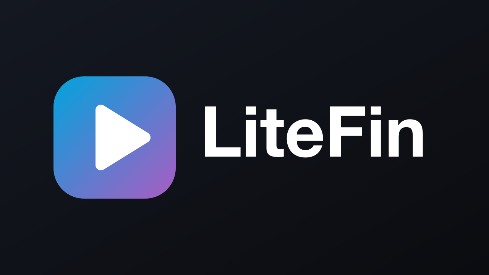
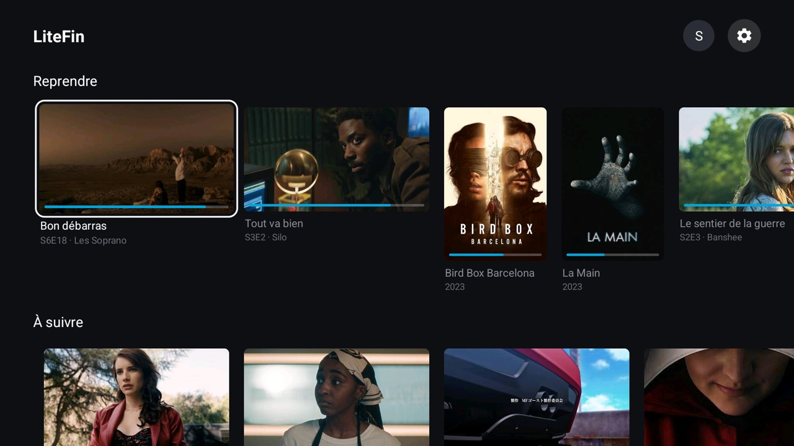
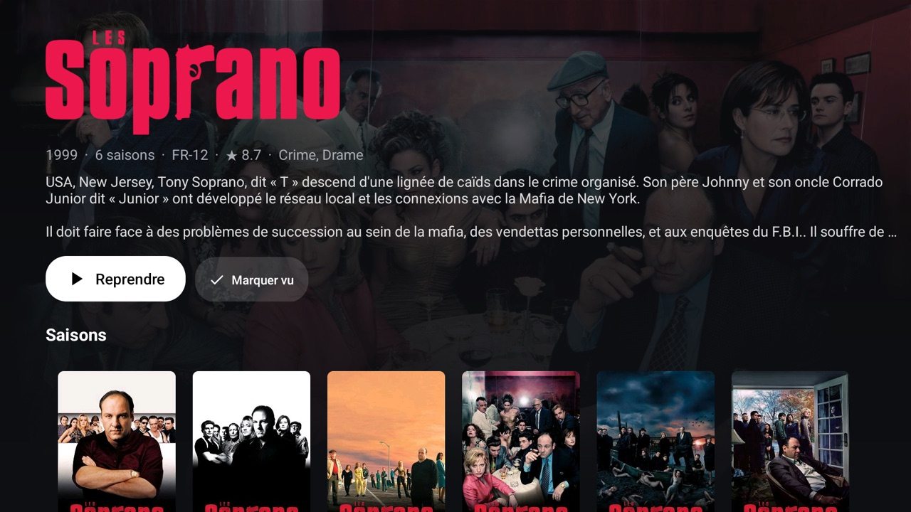
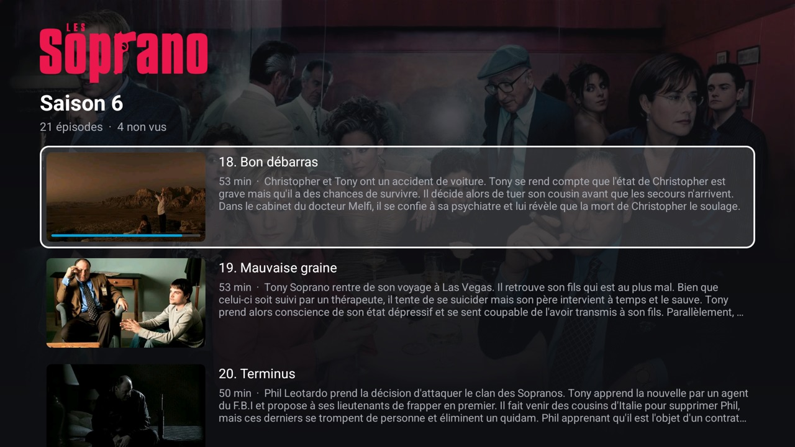
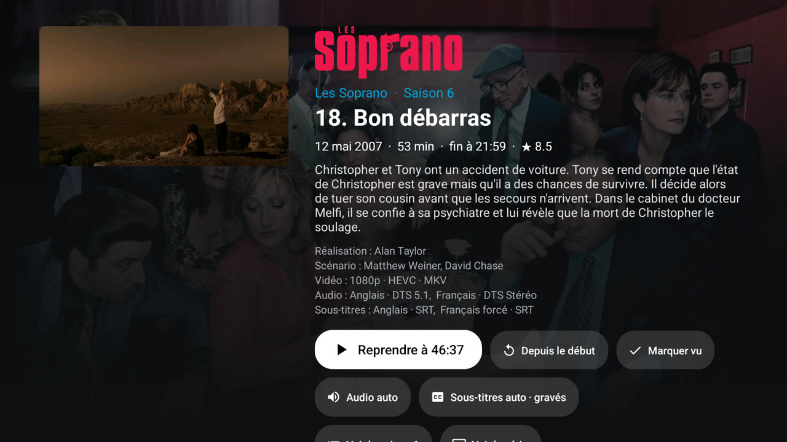
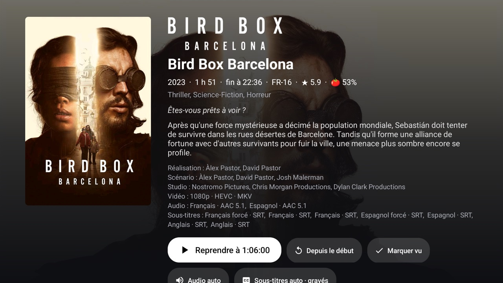
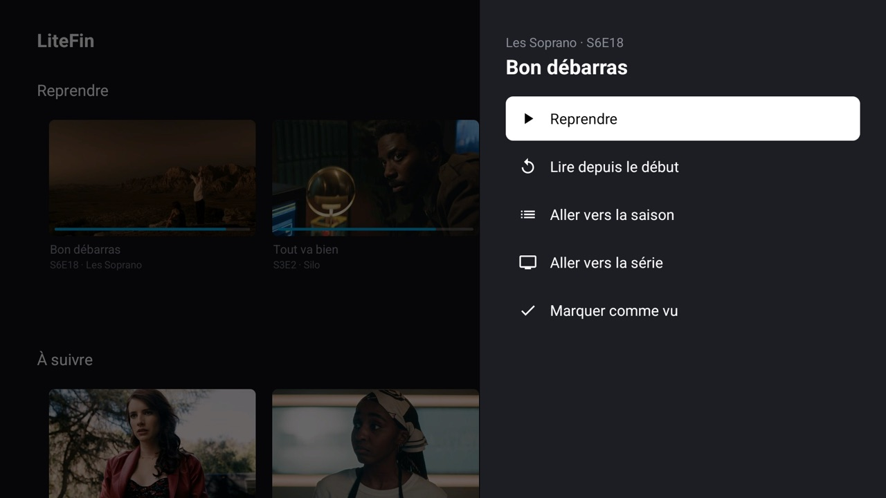
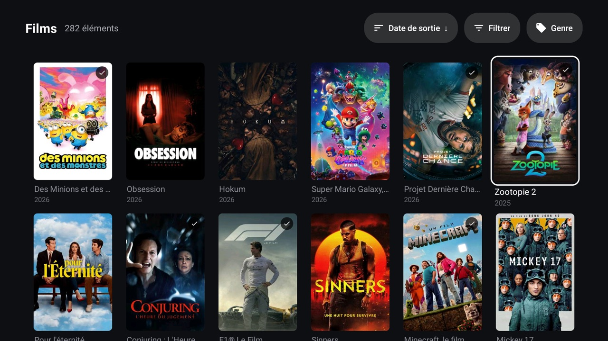
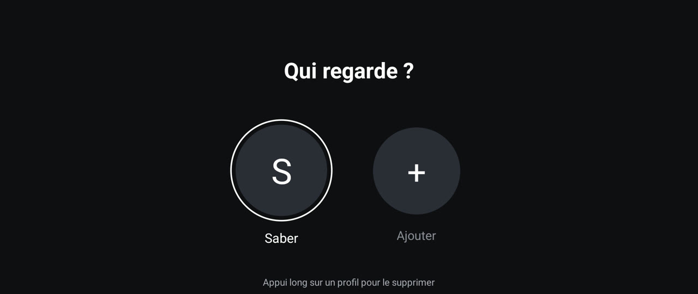

<p align="center">
  
</p>

<p align="center">
  <b>Un client Jellyfin pour Android TV, pensé pour les box qui rament.</b><br>
  Natif, sobre, rapide, et capable de toujours graver les sous-titres.
</p>

<p align="center">
  
  
  
  
  
  <a href="https://github.com/OkilSaber/litefin/releases/latest"></a>
</p>

<p align="center">
  
</p>

---

## Pourquoi LiteFin

Le client Jellyfin officiel est complet, mais lourd pour une petite box Android TV : beaucoup de mémoire,
des animations partout et des menus qui mettent du temps à répondre. LiteFin fait l'inverse : uniquement des
vues Android natives, pas de framework d'UI, et chaque animation doit justifier son coût.

| | LiteFin |
| --- | --- |
| Taille de l'APK | **~1,5 Mo** |
| RAM sur l'accueil | **~40 Mo** (PSS) |
| RAM en lecture | **~80 Mo**, tampon vidéo plafonné à 32 Mo |
| Décodage | matériel (MediaCodec via ExoPlayer) |
| Dépendances | Media3, OkHttp, Coil, RecyclerView, coroutines |

Pas de Compose, pas de Leanback, pas de SDK Jellyfin généré : l'API est appelée à la main, et chaque requête ne
demande que les champs que l'écran affiche.

## Fonctionnalités

**Lecture**
- 🔥 **Toujours graver les sous-titres** (activé par défaut), comme l'option « Graver : tout » du client web. Le serveur
  incruste les sous-titres dans l'image, et la TV n'a plus qu'à décoder une vidéo.
- ⏭️ **Intro Skipper** : boutons « Passer l'intro / le récap / le générique », via l'API Media Segments de
  Jellyfin 10.10+ (avec repli sur l'endpoint du plugin).
- 📑 **Chapitres** : repères sur la barre de progression, nom du chapitre en cours, bouton « Chapitre suivant ».
- 🖼️ **Aperçu pendant l'avance rapide** : vignette *trickplay*, heure d'arrivée et écart parcouru (« +1:09 »). La
  lecture se met en pause pendant que tu cherches.
- 🕘 **Heure de fin** recalculée en continu, même en pause.
- Direct play quand la TV sait décoder, sinon transcodage HLS automatique (avec repli si le direct play échoue).
- Choix des pistes audio et sous-titres avant ou pendant la lecture, et saut avant/arrière réglable (5 à 30 s).
- Avec les contrôles masqués, OK met en pause et ←/→ avance ou recule.

**Navigation**
- Profils multiples (« Qui regarde ? »), ajout par identifiants ou par **Connexion rapide**.
- Accueil : Reprendre, À suivre, bibliothèques et ajouts récents.
- Pages série, saison, épisode et film avec image de fond, logo, distribution, pistes et épisodes suivants.
- **Appui long** sur n'importe quelle carte : reprendre, lire depuis le début, aller à la saison ou à la série,
  marquer vu/non vu.
- Bibliothèques avec **tri, filtres et genres**, mémorisés pour chaque bibliothèque.
- Navigation au D-pad soignée : le focus ne s'échappe jamais d'une rangée, ↑/↓ retombent sur le début de la rangée,
  et les rangées ont une hauteur fixe.

## Captures

<table>
  <tr>
    <td></td>
    <td></td>
  </tr>
  <tr>
    <td align="center"><sub>Série : logo, fond, saisons, distribution</sub></td>
    <td align="center"><sub>Saison : épisodes, progression, résumés</sub></td>
  </tr>
  <tr>
    <td></td>
    <td></td>
  </tr>
  <tr>
    <td align="center"><sub>Épisode : une action principale, pistes, infos techniques</sub></td>
    <td align="center"><sub>Film : affiche, notes, réalisation, pistes</sub></td>
  </tr>
  <tr>
    <td></td>
    <td></td>
  </tr>
  <tr>
    <td align="center"><sub>Appui long : panneau latéral d'actions</sub></td>
    <td align="center"><sub>Bibliothèque : tri, filtres, genres, badges « vu »</sub></td>
  </tr>
  <tr>
    <td colspan="2"></td>
  </tr>
  <tr>
    <td colspan="2" align="center"><sub>Choix du profil au lancement</sub></td>
  </tr>
</table>

## Comment le burn-in fonctionne

Au lancement d'une lecture avec un sous-titre et l'option active, LiteFin :

1. envoie à `POST /Items/{id}/PlaybackInfo` un profil d'appareil qui **ne déclare aucun format de sous-titres** ;
2. désactive le direct play et le direct stream, et ajoute `AlwaysBurnInSubtitleWhenTranscoding` ;
3. le serveur n'a alors pas d'autre choix que `SubtitleMethod=Encode` : les sous-titres sont incrustés dans le flux HLS.

Sans sous-titre, la lecture repasse en direct play, ce qui ne coûte rien à la TV. Si l'option est désactivée, les sous-titres
texte arrivent en WebVTT/SRT et c'est ExoPlayer qui les affiche.

## Installation

Télécharge l'APK de la [dernière release](https://github.com/OkilSaber/litefin/releases/latest), puis installe-le sur la
TV, après avoir activé le débogage ADB dans ses options développeur :

```bash
adb connect <ip-de-la-tv>
adb install -r LiteFin-1.0.0.apk
```

Pour compiler toi-même (JDK 17+ et SDK Android) :

```bash
./gradlew assembleRelease
```

> L'APK release est signé avec la clé de debug, pour pouvoir l'installer directement.

### Côté serveur (optionnel)

- **Intro Skipper** : installe le plugin. Les segments sont lus automatiquement via Media Segments.
- **Aperçus d'avance rapide** : active « Extraction des images trickplay » dans les bibliothèques, puis lance la
  tâche planifiée « Générer des images trickplay ».
- **Connexion rapide** : Tableau de bord > Général > Connexion rapide.

## Sous le capot

```
app/src/main/java/com/litefin/tv/
├── api/        Api.kt (endpoints REST, OkHttp), DeviceProfile.kt (codecs détectés), Models.kt (org.json)
├── data/       Prefs.kt (profils, réglages)
└── ui/         écrans (Activity + Views), SidePanel, SeekPreview, RowLayoutManager…
```

Quelques règles suivies pour ménager une box faible :

- **Pas d'animation sur le focus.** Le D-pad sert des centaines de fois par jour : le focus change
  instantanément (anneau et léger agrandissement). Seules les apparitions occasionnelles sont animées (panneau, fond, contrôles),
  et uniquement en opacité, translation ou échelle.
- **Images au plus juste** : redimensionnées par le serveur, décodées en `RGB_565`, sans fondu sur les cartes. Les vignettes
  trickplay sont découpées dans la planche avec `BitmapRegionDecoder`, sans jamais décoder la planche entière.
- **Peu de requêtes** : un seul `PlaybackInfo` quand c'est possible, des pages rafraîchies avec les seules données
  utilisateur, et un accueil qui ne se recharge que si quelque chose a changé.
- **Lecteur sobre** : tampon limité (10 à 30 s, 32 Mo max), une seule boucle légère à 500 ms, du texte mis à jour seulement
  quand il change.

## Licence

[GPLv3](LICENSE)
